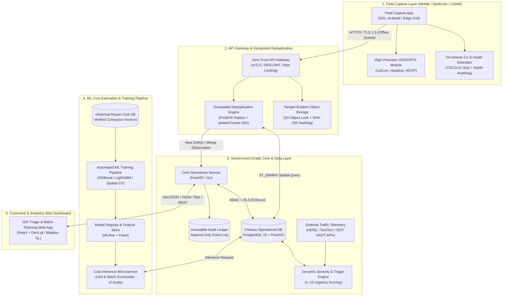

# CivicRoad AI (CR-AI)
### Automated Civic Infrastructure Intelligence, Geospatial Triage & Predictive Repair Costing Platform

[](https://opensource.org/licenses/Apache-2.0)
[](#6-security--compliance-architecture)
[](#4-recommended-tech-stack)
[](#34-ml-repair-cost-estimation-pipeline--training-database)

---

## 1. Executive Summary

### Vision & Problem Statement
Municipalities, state Departments of Transportation (DOTs), and private road-maintenance contractors lose billions of dollars annually to reactive road maintenance, redundant field inspections, unverified contractor billing, and litigation stemming from hazardous pavement defects. Traditional workflows rely on manual 311 citizen reports—which are plagued by duplicate entries, vague location descriptions, and subjective severity assessments—resulting in inefficient dispatch and inaccurate budget forecasting.

**CivicRoad AI (CR-AI)** is a government-grade, end-to-end civic infrastructure platform engineered to automate the entire lifecycle of road defect management: **Edge Detection $\rightarrow$ Geospatial Deduplication $\rightarrow$ Traffic-Weighted Triage $\rightarrow$ ML Cost Estimation $\rightarrow$ Batch Work-Order Bundling**.

### Value Proposition
* **For Municipal & State Governments:** Eliminates duplicate work orders via spatial-visual deduplication, prioritizes repairs objectively using a traffic-weighted 1–10 Severity Index, enforces strict multi-tenant Row-Level Security (RLS) and audit trails for public procurement compliance, and provides defensible capital budget forecasts.
* **For Civil Contractors & Commercial Fleets:** Delivers sub-meter GPS coordinates and physical defect dimensions (length, width, surface area, approximate depth) prior to dispatch, and enables route-optimized batch bidding that accounts for shared mobilization and asphalt/concrete batching economies of scale.

---

## 2. System Architecture

The platform follows a decoupled, event-driven microservices architecture designed for horizontal scalability, zero-trust security, and seamless offline-to-online field synchronization.



### Architectural Data Flow
1. **Capture & Edge Extraction:** The mobile/vehicle-mounted capture client detects a pothole, computes physical dimensions using camera intrinsics + monocular/LiDAR depth estimation, binds high-precision GNSS telemetry, and signs the payload with a SHA-256 integrity hash.
2. **Spatial-Visual Deduplication:** Upon ingestion, the Deduplication Engine queries PostGIS (`ST_DWithin`) within a configurable radius (e.g., $3.0\text{ m}$) and compares visual embeddings and bounding dimensions. Matches increment an `observation_count` and update degradation velocity rather than creating duplicate tickets.
3. **Traffic-Weighted Triage:** The Triage Engine cross-references defect geometry with road classification and Average Annual Daily Traffic (AADT) / live congestion feeds to assign a deterministic **Priority Score (1.0–10.0)**.
4. **ML Cost Prediction:** The Cost Inference Service queries the trained regression ensemble to output an itemized repair estimate (material volume, labor hours, traffic control, and mobilization).
5. **Command & Batch Planning:** Engineers inspect defects on the GIS dashboard, group nearby defects into work orders, and calculate bundled savings via the Batch-Planning Module.

---

## 3. Core Features & Functional Modules

### 3.1 Field Capture App / Tool (Edge Detection & Telemetry)
Designed for municipal inspectors, public works vehicles, and crowdsourced fleet partners:
* **Automated Defect Detection & Photogrammetry:** Real-time bounding-box and instance-segmentation inference extracts pixel masks of pavement distress. Using device focal length, sensor pitch/roll (IMU), and ARKit/ARCore or LiDAR depth maps, the app computes:
  * **Length ($L$)** and **Width ($W$)** in centimeters ($\text{cm}$).
  * **Surface Area ($A$)** in square meters ($\text{m}^2$).
  * **Approximate Depth ($D$)** in centimeters ($\text{cm}$) and estimated **Fill Volume ($V$)** in cubic meters ($\text{m}^3$).
* **Sub-Meter Geospatial Precision:** Captures WGS84 (`EPSG:4326`) latitude/longitude, altitude, compass bearing (heading), Horizontal Dilution of Precision (HDOP), and optional NTRIP/RTK correction metadata so repair crews locate the exact defect on multi-lane roadways.
* **Offline-First Store-and-Forward:** Caches encrypted capture bundles locally in SQLite when operating in cellular dead zones, syncing automatically with exponential backoff once connectivity resumes.
* **Geospatial Deduplication Engine:**
  * **Stage 1 (Spatial Filter):** Executes a PostGIS spatial index scan (`ST_DWithin(geom, candidate_geom, radius_meters)`) constrained by matching road segment ID and lane heading.
  * **Stage 2 (Attribute & Visual Similarity):** Evaluates dimensional delta ($\Delta A \le 25\%$) and perceptual image hash / CLIP embedding cosine similarity ($\ge 0.82$).
  * **Resolution:** If a duplicate is confirmed, the new capture is appended to the existing `pothole_observations` timeline (enabling longitudinal tracking of pothole growth) rather than spawning a duplicate work order.

### 3.2 Government-Grade Secure Backend & Primary Database
Built to satisfy municipal IT audits, state procurement mandates, and SOC 2 Type II / FedRAMP Moderate controls:
* **Multi-Tenant Jurisdictional Isolation:** A single deployment supports multiple municipalities, districts, or contractor organizations with strict cryptographic and database-level tenant boundaries.
* **Granular RBAC & PostgreSQL RLS:** Role-Based Access Control (`SUPER_ADMIN`, `MUNICIPAL_ENGINEER`, `FIELD_INSPECTOR`, `CONTRACTOR_VIEWER`, `AUDITOR`) reinforced by PostgreSQL Row-Level Security policies ensuring users only query geometries and financial records within their authorized jurisdiction.
* **Tamper-Evident Media & Immutable Audit Logs:** Raw capture imagery is written to WORM (Write-Once-Read-Many) object storage with SHA-256 checksums recorded in the database. Every state transition, cost override, and work-order assignment is logged to an append-only audit table.

### 3.3 Command & Analytics Web Dashboard (GIS + Triage)
A high-performance geospatial web application engineered to render $100,000+$ defect markers smoothly:
* **Interactive Vector-Tile GIS Map:** Displays color-coded defect pins, heatmaps, road network layers, and municipal district boundaries. Clicking any marker reveals high-resolution imagery with segmentation overlays, exact dimensions, GPS accuracy metrics, and longitudinal observation history.
* **Dynamic Severity & Priority Scoring (Scale 1–10):**
  * Computes a composite urgency score $P \in [1.0, 10.0]$ by combining **Physical Severity ($S_{\text{phys}}$)** (depth, surface area, edge spalling, proximity to wheel paths) with **Roadway Exposure ($E_{\text{traffic}}$)** (AADT vehicle volume, speed limit, transit/emergency route status, and school/hospital zone proximity):
    $$P = \text{clamp}\left(10 \times \left(w_1 \cdot \hat{S}_{\text{phys}} + w_2 \cdot \hat{E}_{\text{traffic}} + w_3 \cdot \hat{V}_{\text{growth}}\right),\, 1.0,\, 10.0\right)$$
  * Automatically elevates fast-growing potholes ($\hat{V}_{\text{growth}}$) on high-speed arterials before catastrophic pavement failure occurs.

### 3.4 ML Repair Cost Estimation Pipeline & Training Database
Replaces static rule-of-thumb spreadsheets with data-driven financial forecasting:
* **Historical Repair Training Database:** Curates closed-loop records of completed repairs, linking original defect geometry, pavement surface type (`ASPHALT_HMA`, `CONCRETE_PCC`, `CHIP_SEAL`), road functional class, regional labor/material indices, and **verified final contractor invoice amounts**.
* **Automated Feature Engineering & Regression Ensemble:**
  * Trains gradient-boosted decision trees (**XGBoost** / **LightGBM**) with quantile regression bounds to output a **Point Estimate ($)** alongside an **80% Confidence Interval ($[\text{P10}, \text{P90}]$)**.
  * Decomposes predicted cost into **Material Cost** (hot-mix vs. cold-patch tonnage), **Labor & Equipment Hours**, and **Traffic Control / Lane Closure Overhead**.
* **Continuous Retraining Loop:** As municipal engineers approve final repair invoices, anonymized ground-truth records flow back into the training store with automated drift detection.

### 3.5 Commercial & Municipal Batch-Planning Module
Empowers planners and contractors to optimize capital allocation through spatial clustering:
* **Interactive Multi-Select & Corridor Lasso:** Users select multiple potholes via map polygon/lasso tools, road corridor filters, or automated DBSCAN/HDBSCAN spatial clustering suggestions.
* **Economies-of-Scale Cost Modeling:** When $N$ defects are bundled into a single work order, the Batch Engine recalculates total project cost rather than summing individual unit costs:
  * **Amortized Mobilization:** Shares equipment transport and crew dispatch fees across all defects in the cluster.
  * **Route & Traffic-Control Consolidation:** Merges overlapping lane-closure setups along the same road segment.
  * **Material Batch Discounts:** Applies bulk hot-mix asphalt plant minimums and reduced per-ton pricing, displaying explicit **Standalone Cost vs. Bundled Cost Savings ($ and %)**.
* **Exportable Bid Packages:** Generates standardized PDF/CSV/GeoJSON tender packages ready for municipal procurement portals.

---

## 4. Recommended Tech Stack

| Layer | Technology Choice | Architectural Justification |
| :--- | :--- | :--- |
| **Field Capture (Mobile)** | **React Native (Expo) / Swift & Kotlin Native Modules** | Cross-platform UI paired with native ARKit (iOS) and ARCore (Android) depth APIs and background GNSS telemetry. |
| **Edge Computer Vision** | **YOLOv11-Seg + Depth-Anything-V2 (ONNX / CoreML / TFLite)** | Sub-50ms on-device instance segmentation and relative depth estimation without requiring cloud round-trips in the field. |
| **API Gateway & Auth** | **Kong / AWS API Gateway + Keycloak (OIDC / OAuth 2.1)** | Enterprise SSO, SAML 2.0/OIDC federation with government identity providers, mTLS, and fine-grained JWT claims. |
| **Backend Services** | **Python 3.12 (FastAPI) + Celery / Redis** | High-throughput async REST/GeoJSON APIs, native Pydantic validation, and seamless integration with Python geospatial/ML libraries. |
| **Primary Geospatial DB** | **PostgreSQL 16 + PostGIS 3.4 + pgvector** | Industry gold standard for spatial indexing (`GIST`), meter-accurate geography queries, RLS security, and vector similarity search. |
| **Object Storage** | **AWS S3 / MinIO (S3-Compatible) with Object Lock** | Tamper-evident WORM storage for forensic road imagery, lifecycle tiering, and server-side KMS encryption. |
| **Frontend GIS Dashboard** | **React 19 + TypeScript + Mapbox GL JS / Deck.gl + Tailwind CSS** | Hardware-accelerated WebGL rendering capable of visualizing 100k+ spatial points, polygons, and heatmaps at 60 FPS. |
| **ML Pipeline & MLOps** | **PyTorch, Scikit-Learn, XGBoost, LightGBM, MLflow, Great Expectations** | Reproducible experiment tracking, automated data schema validation, quantile cost regression, and versioned model serving. |
| **Infrastructure & IaC** | **Docker, Kubernetes (EKS/AKS), Terraform, GitHub Actions** | Cloud-agnostic, reproducible infrastructure-as-code suitable for GovCloud or on-premise municipal data centers. |

---

## 5. Database Schema Overview

The data architecture strictly separates **Operational Civic Telemetry** (live defects, work orders, audit logs) from the **ML Historical Cost Training Store** (curated, reconciled financial ground truth).

### 5.1 Operational Database (`operational_db`)
* **`jurisdictions`**: `id (UUID PK)`, `name`, `boundary (GEOMETRY MultiPolygon, 4326)`, `parent_jurisdiction_id`, `tier_config (JSONB)`.
* **`users` & `roles`**: `id (UUID PK)`, `jurisdiction_id (FK)`, `email`, `role_enum`, `sso_subject_id`, `is_active`.
* **`road_segments`**: `id (UUID PK)`, `osm_way_id / dot_route_id`, `geom (GEOMETRY LineString, 4326)`, `road_class (ARTERIAL | COLLECTOR | LOCAL | HIGHWAY)`, `surface_type`, `aadt_traffic_count (INT)`, `speed_limit_mph (INT)`.
* **`potholes` (Canonical Defect Entity)**:
  * `id (UUID PK)`, `jurisdiction_id (FK)`, `road_segment_id (FK)`
  * `location (GEOGRAPHY Point, 4326)` — Indexed via `GIST`
  * `length_cm (NUMERIC)`, `width_cm (NUMERIC)`, `area_sqm (NUMERIC)`, `depth_cm (NUMERIC)`, `volume_cbm (NUMERIC)`
  * `severity_score (NUMERIC(3,1))` — Scale `1.0` to `10.0`
  * `estimated_unit_cost (NUMERIC(10,2))`, `cost_confidence_low (NUMERIC)`, `cost_confidence_high (NUMERIC)`
  * `status (REPORTED | TRIAGED | SCHEDULED | IN_PROGRESS | RESOLVED | REJECTED)`
  * `observation_count (INT)`, `first_detected_at (TIMESTAMPTZ)`, `last_observed_at (TIMESTAMPTZ)`
* **`pothole_observations` (Deduplicated Capture History)**:
  * `id (UUID PK)`, `pothole_id (FK)`, `captured_by_user_id (FK)`, `capture_timestamp (TIMESTAMPTZ)`
  * `raw_gps (GEOGRAPHY Point, 4326)`, `gps_accuracy_meters (NUMERIC)`, `heading_degrees (NUMERIC)`
  * `media_s3_uri (TEXT)`, `media_sha256 (CHAR(64))`, `visual_embedding (VECTOR(512))`
  * `measured_area_sqm (NUMERIC)`, `measured_depth_cm (NUMERIC)`
* **`work_orders` & `work_order_items` (Batch Planning)**:
  * `work_orders`: `id (UUID PK)`, `jurisdiction_id (FK)`, `contractor_id (FK)`, `bundle_status`, `standalone_sum_cost`, `bundled_estimated_cost`, `mobilization_savings`, `created_at`.
  * `work_order_items`: `work_order_id (FK)`, `pothole_id (FK)`, `sequence_order (INT)`.
* **`audit_logs` (Immutable Append-Only)**:
  * `id (BIGSERIAL PK)`, `event_timestamp (TIMESTAMPTZ)`, `actor_id (UUID)`, `actor_role`, `entity_type`, `entity_id`, `action`, `previous_state (JSONB)`, `new_state (JSONB)`, `ip_address (INET)`.

### 5.2 ML Cost Training Database (`ml_training_db`)
* **`historical_repairs` (Verified Ground Truth)**:
  * `repair_id (UUID PK)`, `jurisdiction_region_code`, `road_class`, `surface_material`, `weather_season`
  * `final_length_cm`, `final_width_cm`, `final_area_sqm`, `final_depth_cm`, `final_volume_cbm`
  * `batch_size_count (INT)` — `1` for isolated repair, `>1` if executed as part of a bundled crew dispatch
  * `distance_from_depot_km (NUMERIC)`, `traffic_control_required (BOOLEAN)`
  * `verified_material_cost (NUMERIC)`, `verified_labor_cost (NUMERIC)`, `verified_equipment_cost (NUMERIC)`, `total_verified_cost (NUMERIC)` — **Target Variable**
  * `invoice_verified_at (TIMESTAMPTZ)`, `model_training_split (TRAIN | VAL | TEST)`

---

## 6. Security & Compliance Architecture

CivicRoad AI is architected from day one to pass municipal cybersecurity assessments and state/federal procurement reviews:

1. **Zero-Trust Transport & Encryption:**
   * **In Transit:** Strict TLS 1.3 enforcement across all client-to-edge and inter-service communications, with mutual TLS (mTLS) between internal microservices.
   * **At Rest:** AES-256 encryption for PostgreSQL storage volumes, automated snapshots, Redis caches, and S3 media buckets managed via Customer-Managed Keys (CMKs) in AWS KMS / HashiCorp Vault.
2. **Row-Level Security (RLS) & RBAC:**
   * Every database session sets `SET LOCAL app.current_jurisdiction_id = '<tenant_uuid>'`. PostgreSQL RLS policies guarantee that even an application-layer query bug cannot leak pothole locations, contractor bids, or PII across municipal boundaries.
3. **Forensic Media Integrity & Privacy:**
   * **Tamper-Evident Hashing:** The mobile client computes a SHA-256 hash over the raw image bytes + GPS coordinates + timestamp prior to upload; the backend verifies and locks the object in WORM storage.
   * **Automated PII Redaction:** An ingestion worker automatically blurs vehicle license plates and pedestrian faces in captured street imagery before storing public-facing derivatives, ensuring GDPR/CCPA and municipal privacy compliance.
4. **Comprehensive Auditability:**
   * All create, update, delete, export, and privilege-escalation events are streamed to an immutable audit ledger and forwardable via Syslog/SIEM connectors (Splunk, Microsoft Sentinel).

---

## 7. Existing Solutions / Related Work

This problem space overlaps several established domains, including road defect detection, pavement management systems, public works asset tracking, and municipal maintenance operations. The closest existing solutions to evaluate are:

### 7.1 Road Defect & Pothole Detection
These projects focus on identifying pavement distress from images, dashcam footage, or mobile scans using computer vision and ML.

* Pothole detection and pavement distress classification
* Road defect recognition from vehicle-mounted cameras
* Cracks, rutting, and surface degradation detection
* Aerial or roadside imagery analysis for infrastructure inspection

Recommended GitHub search terms:
* "pothole detection" "computer vision"
* "road defect detection" "deep learning"
* "pavement distress classification" "dataset"
* "crack detection" "road surface"
* "pothole detection" "dashcam" "computer vision"

### 7.2 Pavement Management & Road Asset Systems
These solutions are more operational and focus on keeping a citywide road inventory, condition indices, and maintenance planning.

* Pavement management systems (PMS)
* Road asset management dashboards
* Condition assessment and maintenance prioritization
* GIS-driven infrastructure monitoring for municipalities

Recommended GitHub search terms:
* "pavement management system" "open source"
* "road asset management" "GIS"
* "municipal road asset management" "dashboard"
* "pavement condition assessment" "Python"
* "road maintenance planning" "GIS"

### 7.3 Municipal Maintenance & Work Order Platforms
These systems help public works teams schedule repairs, manage field crews, and bundle city maintenance work.

* 311 pothole reporting and issue tracking
* Work-order management for infrastructure repairs
* GIS-based maintenance dispatch and crew routing
* Public works and roadway operations dashboards

Recommended GitHub search terms:
* "municipal maintenance dashboard" "GIS"
* "road maintenance work order" "open source"
* "public works dashboard" "infrastructure"
* "pothole reporting" "311"
* "city maintenance management" "road"

### 7.4 Citizen Reporting & Public Transparency Portals
These products focus on the public-facing side of defect reporting, including issue intake, status updates, and public visibility.

* Citizen-reported road damage portals
* 311 reporting workflows
* Public pothole tracking and status dashboards
* Transparency dashboards for municipal repair backlog

Recommended GitHub search terms:
* "311 pothole reporting"
* "citizen road issue reporting" "municipal"
* "public works issue portal" "open source"
* "pothole reporting app" "city"
* "road defect reporting" "dashboard"

### 7.5 Cost Estimation & Infrastructure Forecasting
These are the most adjacent to the predictive costing and budgeting aspect of this project.

* Pavement deterioration forecasting
* Maintenance cost prediction models
* Repair lifecycle and budgeting analytics
* Infrastructure risk and prioritization scoring

Recommended GitHub search terms:
* "pavement deterioration forecasting"
* "road maintenance cost prediction"
* "infrastructure cost estimation" "Python"
* "repair cost modeling" "road"
* "pavement lifecycle cost" "municipal"

### 7.6 Related Open-Source / Research Ecosystem
The broader ecosystem includes:

* CV and image-based defect detection models
* Geospatial analytics for transport/infrastructure
* Public-sector asset intelligence tools
* Government/municipal data platforms for street and road conditions

A strong GitHub query mix would include:
* "pothole detection" "municipal" "GIS"
* "road defect" "asset management" "open source"
* "pavement management" "work order" "dashboard"
* "road inspection" "machine learning"
* "road maintenance" "cost estimation" "Python"

This project distinguishes itself by combining four layers into a single platform:
1. geospatial defect detection and deduplication,
2. objective traffic-weighted triage,
3. ML-based repair cost estimation,
4. municipal work-order bundling and operational planning.

---

## 8. Future Ideas & Roadmap

> **Note:** Items in this section represent planned Phase 5+ enhancements and are excluded from the initial MVP build scope.

### 7.1 Contractor Post-Repair Verification App & Dual-Stage CV Fraud Prevention (Tentative)
To close the financial accountability loop prior to releasing municipal escrow or invoice payments, a dedicated **Contractor Verification Mobile Module** is planned for future releases:
* **Geofenced Capture Enforcement:** Contractors must capture a post-repair photo on-site. The app blocks submission unless live GNSS coordinates fall within a strict radius (e.g., $\le 2.5\text{ m}$) of the original defect's `potholes.location` and compass heading aligns within $\pm 25^\circ$.
* **Dual-Stage Computer Vision Verification Pipeline:**
  * **Stage A — Structural & Geospatial Scene Matching:** Uses local feature-matching transformers (e.g., LoFTR / SuperPoint + LightGlue) to compare static background landmarks (curbs, lane markings, utility covers, cracks outside the patch zone) between the original pre-repair image and the submitted post-repair image, preventing contractors from photographing an undamaged stretch of road nearby.
  * **Stage B — Genuine Repair & Anti-Spoofing Classifier:** Evaluates the target defect bounding region to verify fresh asphalt/concrete compaction and flush surface geometry while flagging fraudulent submissions (e.g., photos of computer screens, AI-generated patches, loose gravel fills, or unrelated "joke" uploads) for human audit review.

### 7.2 Additional Long-Term Capabilities
* **Predictive Pavement Deterioration Modeling:** Time-series forecasting combining weather freeze-thaw cycles, heavy-truck AADT, and historical patch density to predict where potholes will form 6–12 months in advance.
* **Autonomous Municipal Fleet Integration:** Direct ingestion pipelines for dashcams mounted on existing garbage trucks, street sweepers, and snowplows for passive daily city-wide road scanning.
* **311 Citizen Portal & Public Transparency Map:** Read-only public portal allowing citizens to check whether a pothole is already logged, view its priority score, and see scheduled repair dates.

---

## 8. Proposed Repository Structure & Development Phases

### 8.1 Monorepo Structure
```text
civicroad-ai/
├── README.md                          # Master architectural blueprint (this document)
├── docker-compose.yml                 # Local dev stack (PostGIS, Redis, MinIO, Keycloak)
├── .github/
│   └── workflows/                     # CI/CD pipelines (lint, spatial tests, container build)
├── docs/
│   ├── architecture/                  # ADRs (Architecture Decision Records) & sequence diagrams
│   └── api/                           # OpenAPI 3.1 specifications
├── infrastructure/
│   └── terraform/                     # Gov-grade cloud modules (VPC, RDS PostGIS, KMS, S3 Lock)
├── services/
│   ├── core-api/                      # FastAPI backend, RBAC/RLS middleware, Triage & Batch engines
│   │   ├── app/
│   │   │   ├── api/v1/                # REST & GeoJSON endpoints
│   │   │   ├── core/                  # Security, JWT, RLS session context, audit logging
│   │   │   ├── models/                # SQLAlchemy + GeoAlchemy2 ORM models
│   │   │   └── services/              # Deduplication, Priority Scoring, Batch Cost Calculator
│   │   └── tests/                     # Pytest + PostGIS spatial integration tests
│   └── ml-cost-engine/                # ML training pipelines, feature engineering, inference API
│       ├── pipelines/                 # XGBoost/LightGBM training & evaluation scripts
│       ├── inference/                 # FastAPI model serving microservice
│       └── notebooks/                 # Exploratory cost analysis & spatial cross-validation
├── apps/
│   ├── command-dashboard/             # React + TypeScript + Deck.gl GIS Triage & Batch Web App
│   └── field-capture-app/             # React Native / Expo mobile capture & edge CV client
└── db/
    ├── migrations/                    # Alembic versioned migrations (PostGIS + RLS policies)
    └── seeds/                         # Synthetic municipal road networks & historical cost datasets
```

### 8.2 Phased Implementation Roadmap
* **Phase 1 — Foundation & Master Blueprint (Completed):** System architecture, database schema design, security posture, and repository specification (`README.md`).
* **Phase 2 — Core Geospatial Backend & Security Layer:** Provision PostgreSQL + PostGIS schema, implement RBAC + RLS tenant isolation, build the Geospatial Deduplication Engine, and deploy the Dynamic Severity & Priority Scoring service.
* **Phase 3 — ML Cost Pipeline & Batch-Planning Engine:** Stand up the Historical Repair Training DB, train the initial XGBoost/LightGBM repair cost regression model, and implement the economies-of-scale Batch-Planning calculator.
* **Phase 4 — Command GIS Dashboard & Field Capture Client:** Deliver the interactive Mapbox/Deck.gl triage dashboard with multi-select batch bundling, paired with the offline-capable Field Capture mobile app and edge CV dimension estimator.